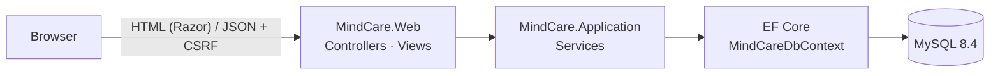

<div align="center">


# MindCare · Central Clinic

**Painel de gestão para clínicas de saúde mental: agenda, pacientes, financeiro e equipe em um só lugar.**

[](https://github.com/eroskarsburg/mindcare-central-clinic/actions/workflows/ci.yml)


[](LICENSE)

</div>

---

## Sumário

- [Funcionalidades](#funcionalidades)
- [Stack](#stack)
- [Começando](#começando)
- [Variáveis de ambiente](#variáveis-de-ambiente)
- [Banco de dados e migrations](#banco-de-dados-e-migrations)
- [Testes](#testes)
- [Arquitetura](#arquitetura)
- [Design system](#design-system)
- [Manutenção de dependências](#manutenção-de-dependências)
- [Contribuindo](#contribuindo)

## Funcionalidades

| Área | O que faz |
| --- | --- |
| **Visão geral** | Agenda do dia, taxa de faltas, consultas aguardando confirmação, valores recebidos e a receber. Profissionais veem apenas os próprios atendimentos. |
| **Agenda** | Calendário semanal/diário/mensal (FullCalendar) com arrastar para remarcar, sessões recorrentes (semanal/quinzenal), detecção de conflito por profissional e paciente, status (agendada, confirmada, realizada, falta, cancelada) e sala de teleconsulta gerada automaticamente. |
| **Horários** | Disponibilidade semanal de cada profissional e bloqueios de agenda (férias, feriados da clínica), respeitados ao criar séries. |
| **Pacientes** | Cadastro completo (CPF validado, nascimento, convênio, contato de emergência, endereço, situação e profissional de referência), preferências de aviso e bloqueio de exclusão de quem tem consultas. |
| **Ficha do paciente** | Indicadores (sessões, faltas, saldo em aberto, próxima sessão), histórico de consultas e pagamentos, e atalho para conversar no WhatsApp. |
| **Prontuário** | Evoluções clínicas **criptografadas em repouso** (ASP.NET Data Protection), vinculadas à sessão. Só o autor e o profissional de referência leem; administradores não têm acesso ao conteúdo; toda leitura é auditada. |
| **Documentos** | Anexos em PDF, imagem ou Word com verificação do conteúdo real do arquivo. Documentos **clínicos** ficam restritos ao profissional de referência; **administrativos** ficam visíveis à equipe. |
| **Notificações** | Confirmação de agendamento, aviso de remarcação/cancelamento e lembrete automático por **WhatsApp** (Cloud API oficial da Meta, com botões Confirmar/Cancelar) e **e-mail**. Fila com reenvio automático, link público de confirmação e avisos no sino do painel quando o paciente responde. [Guia de configuração](docs/whatsapp.md). |
| **Financeiro** | Recebimentos em parcelas com data e forma de pagamento (Pix, cartão, dinheiro, transferência, convênio), status calculado automaticamente e **recibo em PDF** com valor por extenso. |
| **Pacotes** | Pacotes de sessões pré-pagos por paciente, consumidos automaticamente ao agendar com "Usar pacote", com controle de sessões restantes, validade e pagamento. |
| **Tipos de serviço** *(admin)* | Sessão individual, casal, avaliação... com duração e valor padrão que preenchem o agendamento. |
| **Relatórios** | Faturado × recebido (12 meses), recebimentos por forma de pagamento, desempenho, ocupação e **repasse por profissional**, inadimplência, exportação para **Excel** e **recibo mensal** do paciente para o IR. |
| **Profissionais** *(admin)* | Cadastro da equipe com criação automática do usuário de acesso. |
| **Usuários** *(admin)* | Perfis de acesso (Administrador/Profissional), proteção contra remover o último administrador. |
| **Perfil** | Troca de senha (com confirmação da senha atual) e edição dos dados profissionais. |
| **Auditoria** *(admin)* | Registro de quem criou, alterou, excluiu, exportou ou anonimizou dados, e de todos os logins. |
| **LGPD** | Termo de consentimento por paciente, exportação dos dados do titular (JSON) e anonimização que preserva o histórico. |
| **Interface** | Tema claro/escuro, layout responsivo com menu lateral recolhível, tabelas com busca, ordenação e paginação. |

**Segurança:** autenticação por cookie com políticas de autorização por perfil, senha temporária aleatória com troca obrigatória no primeiro acesso, bloqueio de conta após tentativas erradas e limite de requisições no login, senhas com hash PBKDF2 (formato do ASP.NET Core Identity; senhas legadas em texto puro são convertidas no primeiro login), proteção CSRF em todas as requisições de escrita, consultas parametrizadas via EF Core e nenhum segredo versionado.

## Stack

| Camada | Tecnologia |
| --- | --- |
| Back-end | ASP.NET Core MVC · .NET 10 · C# |
| Dados | Entity Framework Core 10 · provider oficial `MySql.EntityFrameworkCore` · MySQL 8.4 |
| Front-end | Razor · Bootstrap 5.3 · Bootstrap Icons · DataTables 3 · JavaScript sem jQuery |
| Testes | xUnit v3 · Microsoft.Testing.Platform · SQLite em memória |
| Documentos | QuestPDF (recibos) · ClosedXML (Excel) · Chart.js (gráficos) · MailKit (e-mail) |
| Infra | Docker (multi-stage) · Docker Compose · GitHub Actions · Dependabot |

## Começando

### Opção 1: Docker (recomendado)

Requer apenas [Docker](https://docs.docker.com/get-docker/).

```bash
git clone https://github.com/eroskarsburg/mindcare-central-clinic.git
cd mindcare-central-clinic

cp .env.example .env        # ajuste as senhas
docker compose up -d --build
```

Acesse **http://localhost:8080** e entre com `Seed__AdminUsername` / `Seed__AdminPassword` definidos no `.env`.

> Para ver a aplicação com dados de exemplo, adicione `Seed__DemoData=true` ao `.env` antes de subir pela primeira vez.

### Opção 2: Localmente

Requer [.NET SDK 10](https://dotnet.microsoft.com/download), [Node.js 20+](https://nodejs.org) e um MySQL 8.

```bash
cp .env.example .env              # aponte ConnectionStrings__MindCare para o seu MySQL
dotnet tool restore               # instala o dotnet-ef local
dotnet run --project src/MindCare.Web
```

- O `.env` da raiz é carregado automaticamente (via [DotNetEnv](https://github.com/tonerdo/dotnet-env)) sem sobrescrever variáveis já definidas no sistema.
- No primeiro build, as bibliotecas front-end são instaladas via `npm` e copiadas para `wwwroot/lib`.
- As migrations são aplicadas e o administrador inicial é criado na inicialização.
- Em `Development`, a base vazia é populada com dados de demonstração.

A aplicação sobe em **http://localhost:5287**. O endpoint **`/health`** informa o estado da aplicação e do banco.

## Variáveis de ambiente

Toda a configuração sensível vem do ambiente. O `appsettings.json` não contém segredos. Veja [`.env.example`](.env.example).

| Variável | Obrigatória | Descrição |
| --- | :---: | --- |
| `ConnectionStrings__MindCare` | ✅ | String de conexão MySQL. No Docker Compose é montada a partir das variáveis `MYSQL_*`. |
| `Seed__AdminUsername` / `Seed__AdminPassword` | ✅ na 1ª execução | Administrador criado quando ainda não existe nenhum. |
| `Seed__DemoData` | | `true` popula uma base vazia com dados fictícios. Padrão: ligado só em `Development`. |
| `Security__MaxFailedLoginAttempts` / `Security__LockoutMinutes` | | Bloqueio de conta após tentativas de login erradas. Padrão: 5 tentativas, 15 minutos. |
| `Teleconsult__BaseUrl` | | Servidor de videochamada das teleconsultas. Padrão: `https://meet.jit.si`. |
| `Notifications__PublicBaseUrl` | Produção | Endereço público usado nos links enviados ao paciente (ex.: `https://agenda.suaclinica.com.br`). |
| `Notifications__ReminderHoursBefore` | | Antecedência do lembrete automático. Padrão: `24`. |
| `WhatsApp__Mode` | | `Disabled`, `Simulated` ou `Live`. Veja o [guia do WhatsApp](docs/whatsapp.md) para `PhoneNumberId`, `AccessToken`, `AppSecret` e `VerifyToken`. |
| `Email__Enabled` / `Email__Host` / `Email__Port` / `Email__Username` / `Email__Password` / `Email__FromAddress` | | Envio de e-mails por SMTP. `Email__PickupDirectory` grava `.eml` em disco (desenvolvimento). |
| `DataProtection__KeysPath` | Produção | Pasta das chaves que cifram o prontuário e o cookie de login. **Precisa ser persistente** (o volume `app-data` no Docker). Padrão: `App_Data/keys`. |
| `Storage__Path` / `Storage__MaxUploadMegabytes` | | Pasta dos documentos dos pacientes e tamanho máximo por arquivo. Padrão: `App_Data/storage`, 10 MB. |
| `Database__ApplyMigrationsOnStartup` | | Aplica migrations ao iniciar. Padrão: `true`. |
| `Clinic__Name` / `Clinic__Tagline` | | Nome e slogan exibidos na interface. |
| `Clinic__LegalName` / `Clinic__Cnpj` / `Clinic__Address` / `Clinic__City` | | Dados impressos nos recibos em PDF. |
| `ASPNETCORE_ENVIRONMENT` | | `Development`, `Staging` ou `Production`. |
| `MYSQL_DATABASE`, `MYSQL_USER`, `MYSQL_PASSWORD`, `MYSQL_ROOT_PASSWORD` | Docker | Credenciais do container MySQL. |
| `APP_PORT`, `MYSQL_PORT` | | Portas publicadas pelo Compose (padrão `8080` e `3306`). |

## Banco de dados e migrations

O esquema é versionado por migrations do EF Core em `src/MindCare.Application/Persistence/Migrations`. Os nomes de tabelas e colunas seguem o modelo original do projeto (`clients`, `appointments`, `payments`...).

```bash
# Criar uma nova migration após alterar o modelo
dotnet ef migrations add NomeDaMudanca \
  --project src/MindCare.Application --startup-project src/MindCare.Application \
  --output-dir Persistence/Migrations

# Aplicar manualmente (opcional: a aplicação já aplica ao iniciar)
dotnet ef database update --project src/MindCare.Application --startup-project src/MindCare.Application

# Gerar script SQL idempotente para produção
dotnet ef migrations script --idempotent --project src/MindCare.Application --startup-project src/MindCare.Application
```

> **Migrando da versão anterior?** O esquema novo adiciona chaves estrangeiras, índices únicos e valores `DECIMAL`. A forma mais simples é subir uma base nova e reimportar os cadastros. As senhas antigas continuam funcionando e são convertidas para hash no primeiro login.

## Testes

```bash
dotnet test
```

Cobrem as regras de domínio (status de pagamento, validação de CPF), o hash de senhas (inclusive a migração de senhas legadas) e os serviços: unicidade de CPF, exclusões em cascata, proteção de administradores e criação de profissionais. Os serviços são testados contra SQLite em memória, com o mesmo modelo do EF Core usado em produção.

## Arquitetura

```
mindcare-central-clinic/
├── src/
│   ├── MindCare.Application/        # Domínio, regras de negócio e acesso a dados
│   │   ├── Domain/                  # Entidades e enums
│   │   ├── Services/                # Casos de uso (Clientes, Agenda, Financeiro, Auth…)
│   │   ├── Persistence/             # DbContext, mapeamentos, migrations e seed
│   │   └── Security/                # Hash de senhas
│   └── MindCare.Web/                # ASP.NET Core MVC
│       ├── Controllers/             # Páginas + endpoints JSON (POST/PUT/DELETE)
│       ├── Infrastructure/          # Filtros, extensões e configuração
│       ├── Models/                  # Modelos de entrada com validação
│       ├── Views/                   # Razor
│       └── wwwroot/                 # CSS (design system), JS e imagens
├── tests/MindCare.Application.Tests # xUnit v3
├── Dockerfile · docker-compose.yml
├── Directory.Build.props            # Configuração comum (net10.0, nullable, analyzers)
└── Directory.Packages.props         # Versões centralizadas dos pacotes NuGet
```



- **Backups:** além do banco (volume `mysql-data`), faça backup do volume `app-data`. Ele contém as chaves de criptografia do prontuário: sem elas, as evoluções não podem ser lidas.
- **Páginas** são renderizadas no servidor. As **ações de escrita** são endpoints JSON consumidos por um único módulo JavaScript genérico de CRUD (`wwwroot/js/app.js`).
- Erros de regra de negócio (`BusinessException`) viram respostas `400 { message }`, exibidas como toast.
- Builds rodam com `TreatWarningsAsErrors` e os analisadores recomendados do .NET.

## Design system

Paleta **"Terra & Ardósia"**, derivada do taupe original do projeto e da ilustração da clínica, com modo escuro.

| | Token | Hex | Uso |
| --- | --- | --- | --- |
|  | Taupe | `#A9927D` | Cor-assinatura (herdada da versão original) |
|  | Mocha | `#7D6049` | Ações primárias |
|  | Ardósia | `#2F3E46` | Menu lateral e login |
|  | Blush | `#F2A7A0` | Destaques e item ativo |
|  | Sálvia | `#7F9C7A` | Sucesso / pago |
|  | Mel | `#D4A24C` | Parcial / atenção |
|  | Argila | `#C0645A` | Pendente / perigo |
|  | Linho | `#F7F3EE` | Fundo |

Tipografia: **Fraunces** (títulos) e **Plus Jakarta Sans** (texto). Os tokens ficam em `src/MindCare.Web/wwwroot/css/site.css`.

## Manutenção de dependências

O [Dependabot](.github/dependabot.yml) abre PRs semanais (segunda-feira) para:

- **NuGet**, com grupos para EF Core, testes e demais pacotes;
- **SDK do .NET** (`global.json`);
- **npm** (Bootstrap, Bootstrap Icons, DataTables, FullCalendar, Chart.js);
- **Docker** (imagens do `Dockerfile` e do `docker-compose.yml`);
- **GitHub Actions**.

O [CI](.github/workflows/ci.yml) valida cada PR com build, testes, checagem de migrations pendentes e build da imagem Docker.

## Contribuindo

Contribuições são bem-vindas! Veja o [guia de contribuição](CONTRIBUTING.md) e o padrão de commits do projeto.

## Licença

Distribuído sob a licença [MIT](LICENSE).

Os recibos usam o [QuestPDF](https://www.questpdf.com/license/) na licença **Community**, gratuita para organizações com receita bruta anual inferior a US$ 1 milhão. Acima disso, é necessária uma licença comercial.
