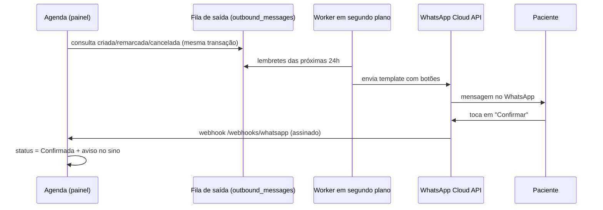

# Notificações por WhatsApp e e-mail

O MindCare avisa o paciente automaticamente quando uma consulta é **agendada**, **remarcada** ou **cancelada**, e envia um **lembrete** antes da sessão (24h por padrão). No WhatsApp, as mensagens trazem botões **Confirmar** e **Cancelar**. A resposta do paciente atualiza a agenda e gera um aviso no sino do painel para a equipe.



## Como funciona

- **Fila de saída (outbox):** cada mensagem é gravada na tabela `outbound_messages` junto com a alteração da consulta. Um processo em segundo plano (`NotificationWorker`) faz o envio a cada `Notifications__WorkerIntervalSeconds`. Falhas temporárias são tentadas de novo em 1, 4, 9 e 16 minutos; falhas definitivas (número inválido, template recusado) param na hora. O histórico fica em **Administração → Mensagens**, com a opção **Reenviar**.
- **Link de confirmação:** toda mensagem (exceto cancelamento) leva um link `https://<sua-clínica>/c/<token>` em que o paciente confirma ou cancela sem precisar de login. O banco guarda apenas o hash SHA-256 do token, e cada nova mensagem invalida o link anterior.
- **Preferências do paciente:** no cadastro do paciente ficam o celular, o e-mail e os interruptores "Lembretes pelo WhatsApp" e "Por e-mail". Pacientes anonimizados nunca recebem mensagens.
- **Mensagens livres:** se o paciente escrever no WhatsApp (por exemplo, "posso trocar para as 16h?"), a equipe recebe um aviso no sino com o texto.

## Modos

| `WhatsApp__Mode` | Comportamento |
| --- | --- |
| `Disabled` (padrão) | Nada é enviado por WhatsApp. |
| `Simulated` | As mensagens são registradas no log como se fossem enviadas. É o padrão em `Development`. |
| `Live` | As mensagens são enviadas pela WhatsApp Cloud API. |

O e-mail segue a mesma ideia: `Email__Enabled=true` com SMTP (`Email__Host`, `Email__Port`, `Email__Username`, `Email__Password`). Com `Email__PickupDirectory` definido, os e-mails são gravados como arquivos `.eml` em vez de enviados, que é o padrão em desenvolvimento (`App_Data/mail`).

## Configurando a WhatsApp Cloud API (Meta)

1. **Conta e número:** crie um app do tipo *Business* em [developers.facebook.com](https://developers.facebook.com/), adicione o produto **WhatsApp** e registre o número da clínica no **WhatsApp Manager**.
2. **Token permanente:** em *Business Settings → System users*, crie um usuário do sistema com permissão `whatsapp_business_messaging` e gere um token sem expiração.
3. **Variáveis de ambiente:**

   ```env
   WhatsApp__Mode=Live
   WhatsApp__PhoneNumberId=123456789012345   # "Phone number ID" no painel do WhatsApp
   WhatsApp__AccessToken=EAAG...             # token do usuário do sistema
   WhatsApp__AppSecret=abc123...             # App Settings → Basic → App secret
   WhatsApp__VerifyToken=um-texto-secreto    # você escolhe; usado na verificação do webhook
   Notifications__PublicBaseUrl=https://agenda.suaclinica.com.br
   ```

4. **Webhook:** em *WhatsApp → Configuration*, informe a URL `https://agenda.suaclinica.com.br/webhooks/whatsapp` e o mesmo `VerifyToken`. Assine o campo **messages**. O endpoint valida a assinatura `X-Hub-Signature-256` com o `AppSecret`, e requisições sem assinatura válida são recusadas.
5. **Templates:** cadastre e aprove os quatro templates abaixo em *WhatsApp Manager → Message templates*. Use a categoria **Utility** e o idioma **Portuguese (BR)**. Os nomes podem ser alterados via `WhatsApp__Templates__Agendamento`, `__Remarcacao`, `__Cancelamento` e `__Lembrete`.

### Templates

Todos usam os mesmos parâmetros do corpo, nesta ordem:

| Parâmetro | Conteúdo | Exemplo |
| --- | --- | --- |
| `{{1}}` | Primeiro nome do paciente | Ana |
| `{{2}}` | Profissional | Letícia Kasper |
| `{{3}}` | Data | sexta-feira, 30/10 |
| `{{4}}` | Horário | 15:00 |
| `{{5}}` | Modalidade (com link da sala, se teleconsulta) | presencial |
| `{{6}}` | Complemento (séries, por exemplo) ou `-` | Sessões semanais: 8 encontros agendados. |

Os templates de agendamento, remarcação e lembrete têm **dois botões de resposta rápida**, nesta ordem: **Confirmar** (índice 0) e **Cancelar** (índice 1). O MindCare preenche o *payload* de cada botão automaticamente.

**`mindcare_agendamento`**

> Olá, {{1}}! Sua consulta com {{2}} foi agendada para {{3}} às {{4}} ({{5}}). {{6}}
>
> Toque em um dos botões para confirmar sua presença ou cancelar.

**`mindcare_remarcacao`**

> Olá, {{1}}! Sua consulta com {{2}} foi remarcada para {{3}} às {{4}} ({{5}}). {{6}}
>
> Podemos contar com você no novo horário?

**`mindcare_lembrete`**

> Olá, {{1}}! Lembrete: você tem consulta com {{2}} em {{3}} às {{4}} ({{5}}). {{6}}
>
> Confirme sua presença ou, se não puder comparecer, cancele com antecedência.

**`mindcare_cancelamento`** (sem botões)

> Olá, {{1}}. Sua consulta com {{2}} de {{3}} às {{4}} foi cancelada. {{6}}
>
> Entre em contato com a clínica para remarcar.

> **Dica:** a Meta pede exemplos para cada parâmetro na aprovação. Use os da tabela acima.

## Testando localmente

Em `Development` o WhatsApp fica **simulado** e os e-mails vão para `src/MindCare.Web/App_Data/mail`. Para receber webhooks reais na sua máquina, exponha a aplicação com um túnel (ex.: `ngrok http 5287`), use a URL HTTPS gerada em `Notifications__PublicBaseUrl` e no cadastro do webhook, e mude `WhatsApp__Mode` para `Live`.

## Privacidade (LGPD)

- As mensagens contêm apenas nome, data, horário, profissional e modalidade. **Nunca** incluem anotações ou dados clínicos.
- O consentimento para receber mensagens é controlado por paciente (interruptores no cadastro).
- O token do link fica em texto puro apenas na fila, até o envio, e depois é apagado. No banco permanece só o hash.
